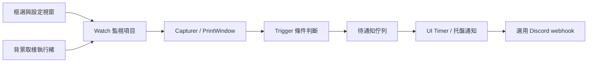

# SCMWC 程式架構

SCMWC 是 C# / .NET Framework 的 Windows 桌面工具，使用 WinForms 和 Win32/GDI 抓取指定視窗的像素。它從畫面變化推測通知時機，並不讀取目標程式的內部工作狀態。

## 模組分工

| 模組 | 職責 |
| --- | --- |
| `TrayApp.cs` | Main 入口、ApplicationContext、監視項目管理、背景取樣執行緒、通知佇列及 UI timer |
| `RegionSelector.cs`、`WatchSettingsForm.cs` | 找出目標視窗和框選區域，設定通知條件、頻率與靈敏度 |
| `Watch.cs` | 單一監視的狀態、取樣排程、DPI 座標轉換、畫面有效性、冷卻、最小化與移出螢幕的處理 |
| `Capture.cs`、`Native.cs` | Win32/GDI 呼叫、PrintWindow、灰階簽章、顏色與進度條橫帶分析，釋放圖形資源 |
| `Trigger.cs` | 畫面變化、進度完成、指定百分比、顏色改變、活動後停止等五類條件 |
| `MainForm.cs`、`Badge.cs`、`Theme.cs` | 狀態與歷史列表、自繪畫面、監視區域旁的控制鈕 |
| `Discord.cs`、`Config.cs` | 設定儲存與背景 webhook 傳送；截圖上傳預設關閉 |
| `License.cs`、`LicenseForm.cs` | 選用的授權啟用、驗證、本機快取與離線寬限狀態 |
| `SelfTest.cs`、`demo/` | 實際視窗抓取、進度條、UI、頻率等診斷入口與測試目標 |
| `installer/`、`site/` | 安裝器與獨立的靜態產品網站；不是桌面監視迴圈的一部分 |

## 一次取樣如何變成通知

背景執行緒取得監視清單快照，讓每個 Watch 判斷是否到取樣時間。Capturer 用 PrintWindow 取得像素，再檢查哨兵色與黑畫面的比例；無效畫面記為 Blind，不當成「沒有變化」。有效畫面才比較簽章並交給 Trigger。

Trigger 回傳原因時，背景執行緒把事件排入佇列。UI timer 取出事件，更新歷史並發出本機通知；若已設定 Discord，就由網路背景工作傳送。抓取工作和網路傳送因此不阻塞 UI 的正常訊息迴圈。

進度完成門檻是估計值 96%，用來容許邊框與圓角；條件成立後需先降回目標以下才重新武裝。進度突然大幅下降也可能推測為兩次取樣之間完成並重跑，這是啟發式判斷，不能保證工作實際成功。

## 建置與驗證

`build.ps1` 使用 Windows 的 .NET Framework C# 編譯器，產生桌面程式、進度條 demo 和安裝器。`test.ps1` 使用合成像素驗證五類 Trigger，不抓取桌面也不呼叫外部網路。需要驗證特定程式能否抓取時，再使用既有 SelfTest 的真實視窗測試。
